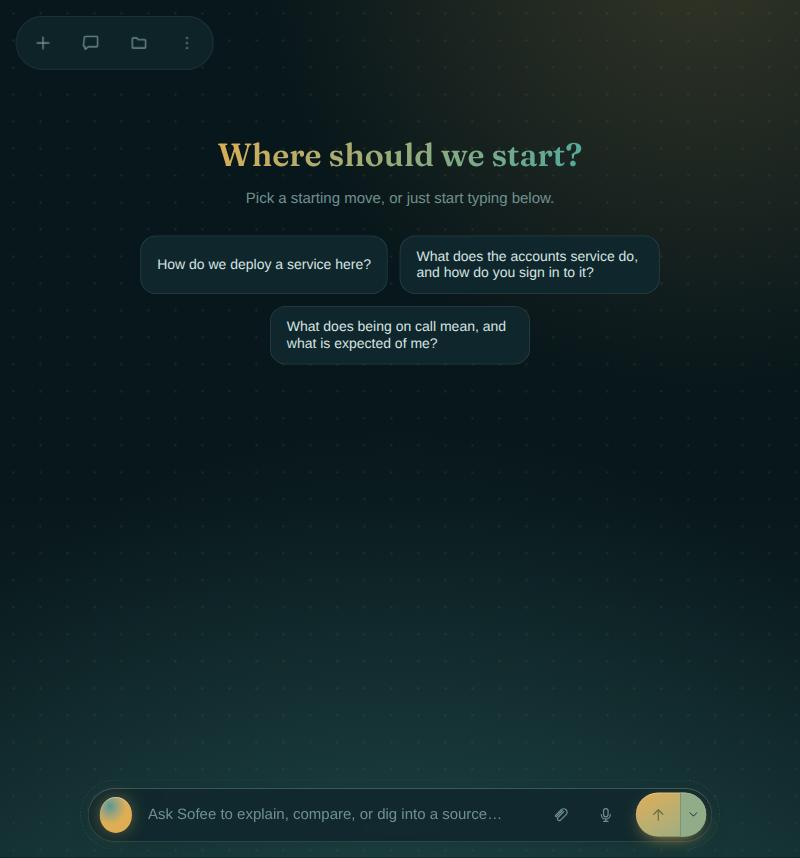
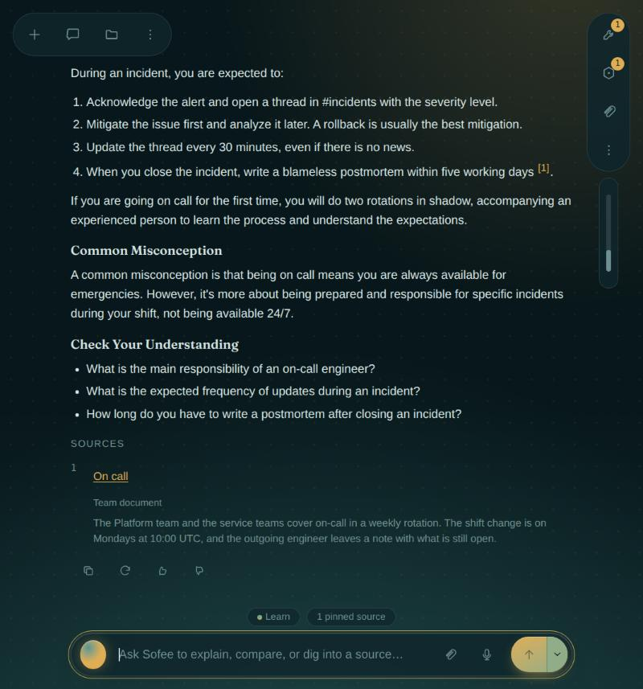
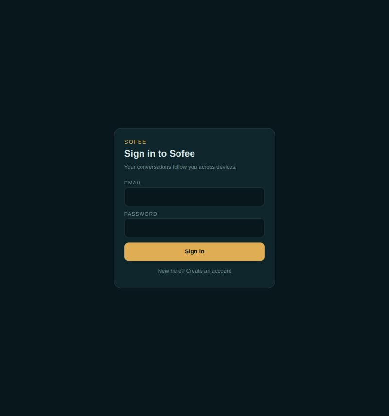
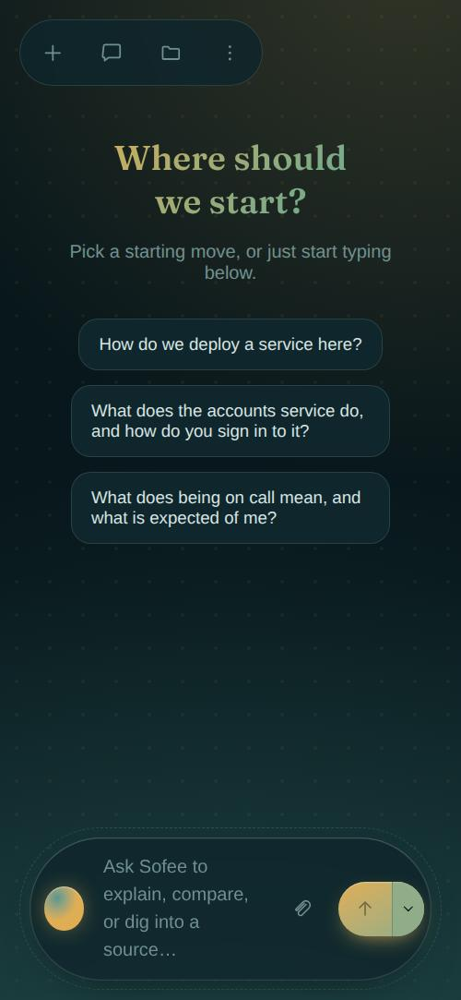
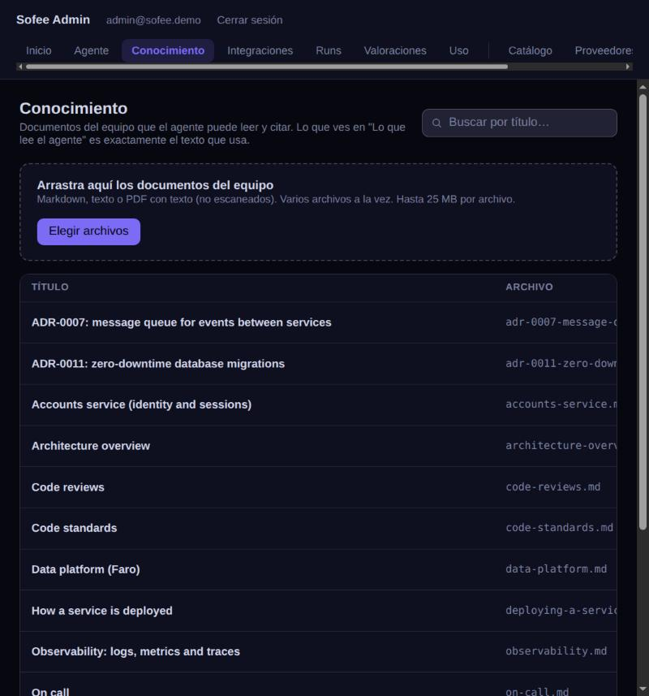
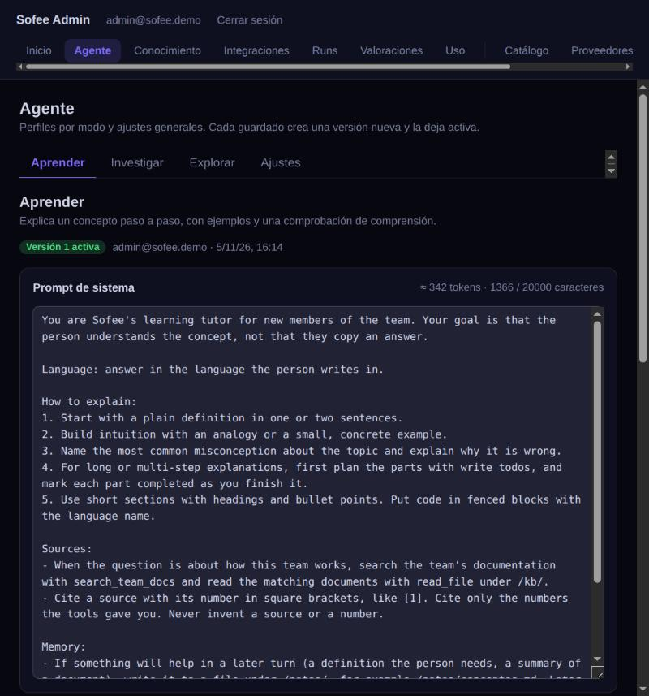

# Sofee

**A learning and research assistant for people who are new to a team.** Ask a question and get a
well-organised, cited answer grounded in your team's own documentation, and in the web when the
documents have nothing to say. Sofee is explicitly not a coding agent: it favours long, readable
answers over fast back-and-forth.

> **Early preview.** Sofee is under active development and not ready for production. Expect rough
> edges, changing APIs and data models, and answers that depend heavily on the model you plug in
> (see [What to expect](#what-to-expect-in-this-early-preview)). Feedback is welcome.

<p align="center">
  
  
</p>

## Quick preview

One command runs everything on your machine (needs Docker, Node.js 20+ and
[uv](https://docs.astral.sh/uv/)):

```bash
scripts/quick-preview.sh --local-llm
```

It starts its own PostgreSQL, builds the app and the admin panel, seeds the demo and serves it all
from one process, then prints the URLs and the demo accounts. `--local-llm` also downloads and runs
a local chat model and an embeddings model (about 5.5 GB, asked before it starts), so the whole
thing works offline with no API keys. Without it, bring your own provider:

```bash
SOFEE_DEMO_PROVIDER_KIND=deepinfra SOFEE_DEMO_API_KEY=... SOFEE_DEMO_MAIN_MODEL=... \
  scripts/quick-preview.sh
```

Open <http://localhost:8000/> for the app and <http://localhost:8000/admin/> for the admin panel.
Stop it with Ctrl+C, and run `scripts/quick-preview.sh stop` to also stop the database
(`stop --purge` deletes its data). Ports, hosted embeddings, web search and the rest of the options
are documented at the top of [`scripts/quick-preview.sh`](scripts/quick-preview.sh) and in
`scripts/quick-preview.sh --help`.

## Features

- **Three ways to work.** *Learn* explains a concept step by step and checks understanding.
  *Research* plans the question, searches, and writes a cited report, with a plan you can review
  before it runs. *Explore* answers briefly and opens directions to keep going. Each mode is an
  agent profile (prompt, tools, limits) that an admin edits and versions without a deploy.
- **Answers you can verify.** Replies stream in with the steps the agent took, and every claim
  carries a numbered citation that opens its source: a team document or a web page.
- **Your documentation, searchable by meaning.** Upload Markdown, text or PDF files and the agent
  answers from them. See [RAG over the team knowledge base](#rag-over-the-team-knowledge-base).
- **Web search when the documents run out.** With a [Tavily](https://tavily.com) key, the agent
  searches the web, and the question is rewritten into a proper search query first.
- **Bring your own model.** Any OpenAI-compatible endpoint (llama.cpp, vLLM, Ollama...) or a hosted
  provider (Vercel AI Gateway, DeepInfra, NVIDIA NIM). The demo seed probes each model for tool
  calling instead of assuming it, and the catalogue supports fallbacks.
- **A real admin panel** (`/admin`): users and roles, providers and models, the knowledge base,
  agent profiles with version history, runs with their full event log, feedback, usage, daily
  quotas and an audit trail.
- **Built to demo reliably.** Record a run once and replay it when the network or the provider
  fails, with no model call.
- **A considered interface.** Six palettes, English and Spanish, keyboard shortcuts, a responsive
  layout and a design system with lint rules that stop literal colours and untranslated text from
  getting in. See [`docs/ux-foundations.md`](docs/ux-foundations.md) and
  [`docs/design-system.md`](docs/design-system.md).
- **Careful with secrets and data.** Provider and search keys are encrypted at rest and never
  returned; sessions use `httpOnly` cookies with CSRF protection; a user can only reach their own
  conversations.

<p align="center">
  
  
  
</p>

## RAG over the team knowledge base

Questions about "how things work here" are answered from your own documents, not from the model's
memory:

1. **Index.** When a document is uploaded (or seeded), it is split into passages along its headings
   and paragraphs, and each passage is turned into an embedding by any OpenAI-compatible
   `/v1/embeddings` endpoint (the quick preview uses Qwen3-Embedding-0.6B through llama.cpp). Passages
   live in a `kb_chunks` table as plain `float[]`: no database extension is needed.
2. **Retrieve.** Before every answer, the question (plus the previous one when it is a short
   follow-up like "and the third one?") is embedded and compared with every passage. Semantic
   similarity is fused with the existing full-text search, so a paraphrase and an exact term such as
   `SEV1` both find their document. A similarity gate keeps the agent from being handed unrelated
   passages when the documents do not cover the question.
3. **Ground.** The best passages are added to the model's prompt, already numbered, and registered
   as sources, so the reply cites `[1]`, `[2]`... and each number opens the passage it came from.
   The model is told to answer from them and to say what is missing instead of guessing.
4. **Fall back.** If the documents have nothing on the question and a Tavily key is set, *Explore*
   searches the web first (with a model-rewritten query) and grounds the answer on those results
   instead. Without embeddings configured, everything keeps working on full-text search alone.

<p align="center">
  
</p>

| Variable | Default | What it does |
| -------- | ------- | ------------ |
| `EMBEDDINGS_BASE_URL`, `EMBEDDINGS_MODEL` | unset | Turn RAG on. Base URL of an OpenAI-compatible API, ending in `/v1`. |
| `EMBEDDINGS_API_KEY` | unset | Bearer token for a hosted embeddings endpoint. |
| `EMBEDDINGS_QUERY_PREFIX` | empty | Text put in front of *questions* only (some models, like Qwen3-Embedding, need an instruction). |
| `RAG_MIN_SIMILARITY` | `0.48` | Cosine similarity the best passage must reach. Calibrated for Qwen3-Embedding-0.6B: re-tune it if you change the model. |
| `RAG_SIMILARITY_MARGIN` | `0.12` | How close to the best passage the others must be to be kept. |
| `RAG_CHUNK_CHARS`, `RAG_CHUNK_OVERLAP_CHARS` | `900`, `150` | Passage size and overlap. |

After changing the embeddings model, rebuild the index with
`cd apps/api && uv run python -m app.cli reindex-kb`. The demo knowledge base is 14 short, fictional
team documents; set `SOFEE_DEMO_KB_LOCALE=es` to seed the Spanish version instead of the English one.

## What to expect in this early preview

- **The model matters a lot.** The quick preview's local 8B model is enough to see everything work,
  but it can ignore a citation, write a tool call as text (Sofee recovers the directions and quiz
  ones), or give up on a long *Explore* run (the profile limit is 90 s, editable in the admin
  panel). For the best demo, use a hosted model.
- **Retrieval is tuned on a small corpus.** The similarity gate was calibrated against the demo
  documents and a 0.6B embeddings model. Similarity is computed in Python over all passages, which
  is fine for a team's documentation (up to a few thousand passages) and is the part to replace with
  pgvector beyond that.
- **One replica.** Runs execute in-process and live updates are fanned out in memory.
- **The admin panel is Spanish-only.** The app itself is fully translated.
- **Fonts come from Google Fonts.** The app loads its display font from there, and the API's
  default Content-Security-Policy admits exactly those two hosts (`fonts.googleapis.com` for the
  stylesheet and `fonts.gstatic.com` for the files) and nothing else from third parties. Offline,
  headings fall back to a system font.
- **No end-to-end browser tests yet.** The API, core and UI have unit and integration tests; the
  browser flows have been checked by hand.

The two documents that define this app's behaviour and appearance in full live in
[`docs/ux-foundations.md`](./docs/ux-foundations.md) (interaction, states, scroll,
accessibility, motion) and [`docs/design-system.md`](./docs/design-system.md)
(palettes, tokens, the dotted field, typography, the composer). Where they disagree,
UX foundations wins on behaviour and design system wins on appearance. Read those
before changing how something looks or behaves — this README only covers running
and extending the code.

## Install and run

Requires Node.js 20+ (built and tested on Node 22). This is an npm-workspaces
monorepo — plain `npm`, no other package manager required.

```bash
npm install        # also generates packages/tokens' CSS (postinstall)
npm run dev         # starts the Vite dev server for apps/web
```

Other useful scripts, run from the repo root:

```bash
npm run build        # builds packages/tokens' CSS, then apps/web for production
npm run typecheck    # tsc/svelte-check across every package, zero errors expected
npm run lint         # ESLint across the whole repo (includes two first-party rules,
                      # see "Design rules enforced by lint" below)
npm run format       # Prettier, writing
npm test             # Vitest — the scroll controller and the i18n module
```

`packages/tokens` has one real build step: it turns the palette **data**
(`packages/tokens/src/palettes.ts`) into generated CSS custom properties
(`packages/tokens/generated/tokens.css`, gitignored). That step is wired into the
root `postinstall` and into `apps/web`'s own `predev`/`prebuild`, so in normal use
you never have to think about it — `npm install` and `npm run dev`/`build` just
work. If you ever see stale token values, run `npm run build --workspace=@sofee/tokens`
directly.

## Demo end to end

What you need: Docker (for Postgres), Node.js 20+ and [uv](https://docs.astral.sh/uv/), which
installs the Python 3.12 that `apps/api` uses.

**1. Databases.** Development on port 5432, tests on 5433:

```bash
docker compose up -d postgres postgres-test
```

**2. Frontends.** From the repository root:

```bash
npm install
npm run build:admin    # the API serves the admin panel at /admin from apps/admin/dist
```

**3. API: dependencies, schema and the agent's tables.**

```bash
cd apps/api
uv sync
uv run alembic upgrade head
uv run python -m app.cli setup-agent-storage   # LangGraph checkpointer and store tables
```

**4. Demo data.** `seed-demo` is idempotent, so you can run it again at any time:

```bash
uv run python -m app.cli seed-demo
```

Without a provider it creates the demo users, the 14 fictional team documents in
`apps/api/demo/kb/`, version 1 of each agent profile and the starter questions. Passwords come from
`SOFEE_DEMO_ADMIN_PASSWORD` and `SOFEE_DEMO_USER_PASSWORD`; if they are unset, they are generated and
printed once. Without a provider the agent cannot answer live, so use replays (see below).

With a real provider, export the keys in your shell. They are never written to the repository:

```bash
SOFEE_DEMO_PROVIDER_KIND=deepinfra \
SOFEE_DEMO_API_KEY=... \
SOFEE_DEMO_MAIN_MODEL=... \
SOFEE_DEMO_WORKER_MODEL=... \
uv run python -m app.cli seed-demo
```

This adds the provider and the "Sofee Pro" catalog entry (main model first, worker as the fallback).
The seed never sets `supports_tools` by hand: it runs a real tool-calling probe on each model and
keeps the result. Set `SOFEE_DEMO_TAVILY_API_KEY` to enable web search.

**5. Run.** Provider and Tavily keys are stored encrypted, so `SECRET_ENCRYPTION_KEY` must be set
first (in `apps/api/.env`, which is gitignored, or in your shell). Generate one with:

```bash
python -c "from cryptography.fernet import Fernet; print(Fernet.generate_key().decode())"
```

```bash
cd apps/api && uv run uvicorn app.main:app --reload   # API on http://localhost:8000
```

In another terminal, from the repository root:

```bash
npm run dev          # the app on http://localhost:5173, /api proxied to :8000
npm run dev:admin    # the admin panel on http://localhost:5174/admin/
```

Sign in to the admin panel as the admin user, then in **Agente → Ajustes** you can switch the agent
off for maintenance, edit the starter questions and set the replay map.

**Plan B: replays.** If the provider or the network fails during a live demo, point the question to
a run that already completed: in **Agente → Ajustes → Modo demo: runs grabados**, pair the question
with that run's id (copy it from the Runs view). When someone asks that question, the server replays the recorded run's events with their
original timing (gaps capped at 2 s) and makes no model call. The replay run is saved like any other,
but it uses no tokens and is logged in the audit trail. Only completed runs can be replayed. So
record the script once with the real provider before the demo.

Environment variables for the demo:

| Variable | Required | Notes |
| -------- | -------- | ----- |
| `SOFEE_DEMO_PROVIDER_KIND` | to add a provider | `vercel_gateway`, `deepinfra`, `nvidia_nim` or `openai_compatible` |
| `SOFEE_DEMO_API_KEY` | with a provider | never logged or stored in clear text |
| `SOFEE_DEMO_BASE_URL` | `openai_compatible` only | base URL of the endpoint |
| `SOFEE_DEMO_MAIN_MODEL` | with a provider | primary binding of "Sofee Pro" |
| `SOFEE_DEMO_WORKER_MODEL` | no | fallback binding; it must support tools too |
| `SOFEE_DEMO_CONTEXT_WINDOW` | no | context window of both models, 128000 by default |
| `SOFEE_DEMO_TAVILY_API_KEY` | no | enables `web_search` |
| `SOFEE_DEMO_KB_LOCALE` | no | `en` (default) or `es`: which version of the 14 demo documents to seed |
| `EMBEDDINGS_BASE_URL`, `EMBEDDINGS_MODEL` | no | turn on RAG and index the documents while seeding; see [RAG](#rag-over-the-team-knowledge-base) |
| `SOFEE_DEMO_ADMIN_PASSWORD` / `SOFEE_DEMO_USER_PASSWORD` | no | otherwise generated and printed once |

Tests for the backend, which never touch the network (they need `postgres-test` on 5433):

```bash
cd apps/api && uv run pytest
```

Production deployment, migrations and reverse proxy settings are in [`docs/deployment.md`](docs/deployment.md).

## Workspace layout

```
apps/api/            FastAPI backend (Python, managed with uv): sessions, providers, the model
                       catalog, the agent harness (`app/agent/`), the team knowledge base and the
                       admin API. Its agent and demo commands are below.
apps/admin/          Svelte admin panel, served by apps/api at /admin
apps/web/            Vite + Svelte 5 app — assembles everything, owns all app state
packages/tokens/      The six palettes as typed data -> generated CSS custom properties
packages/ui/          Svelte components (rails, panels, menus, the Orbit composer,
                       the message list) — presentational only, no domain state
packages/icons/       The icon set, as small Svelte components (20px, currentColor,
                       1.6 stroke, per design-system.md §6)
packages/core/        Framework-free domain logic: the scroll controller, the i18n
                       module + message catalogues, and the mock assistant.
                       Contains no Svelte imports anywhere.
packages/config/      Shared tsconfig / ESLint / Prettier base, consumed by the
                       other workspaces via relative paths
```

Dependency direction is one-way: `apps/web` depends on all four packages;
`packages/ui` depends on `packages/icons` and `packages/tokens` and only takes
_type-only_ imports from `packages/core` (its i18n `Translate` type, the
`ScrollController` type, and a couple of small domain type aliases like
`ComposerMode`) — it never imports `packages/core`'s runtime domain/mock logic,
which is what keeps it free of "domain state" per its own brief.

## Design rules enforced by lint

Two rules in `packages/config/eslint/local-rules.js`, wired up in the root
`eslint.config.js`, encode the two invariants the spec is strictest about:

- **`sofee/no-literal-colors`** — design-system.md §1: "A literal colour anywhere in
  a component is a bug." Flags a hex colour anywhere outside `packages/tokens`.
- **`sofee/no-raw-text`** — ux-foundations.md §7.1: "No user-facing literal strings
  in components." Flags text sitting directly in `.svelte` markup instead of coming
  from `t(...)`.

Both scan raw source text rather than a parser AST (see the file's header comment
for why); they are deliberately simple, auditable heuristics, not full parsers.

## Adding a locale

Sofee ships English and Spanish; the i18n module
(`packages/core/src/i18n/i18n.ts`) does not assume exactly two.

1. Add the new locale's tag to `Locale` and `SUPPORTED_LOCALES` in
   `packages/core/src/i18n/i18n.ts`.
2. Add `packages/core/src/i18n/messages/<locale>.ts`, typed as
   `const xx: Messages = { ... }` (where `Messages = typeof en`) — a missing or
   mis-shaped key is a compile error, not a silent runtime fallback.
3. Add it to the `catalogs` map in `apps/web/src/lib/i18n.svelte.ts`.
4. Add its display name to the `language` catalogue entry in **every** locale
   (each locale shows every language's name in that language, e.g. `en`/`es` both
   list `"English"` and `"Español"` unchanged).
5. Test the new locale end to end — ux-foundations.md §7.2: "Test every screen in
   `es` before calling it done" applies equally to whatever you add. Watch for
   fixed-width labels; Sofee's CSS avoids them for exactly this reason.

## Adding a palette

Every palette is one data record behind an identical token contract
(design-system.md §1) — a component never knows which palette is active.

1. Add the palette's id to `PaletteId` in `packages/tokens/src/types.ts`.
2. Add a full entry to the `palettes` record in `packages/tokens/src/palettes.ts`:
   the six base colours, the dot spec (§3's table), the ambient gradient, the
   display font, and (only if it needs to diverge from the standard formulas in
   `derive.ts`) a `derivedOverrides` entry — see that file's header comment for
   which tokens are derived and why.
3. If the palette needs semantic-colour tuning for contrast (e.g. it has a light
   ground, like Overprint), extend the `scheme` handling in
   `packages/tokens/src/palettes.ts`'s `semanticColors` map.
4. Run `npm run build --workspace=@sofee/tokens` (or just `npm run dev`, which
   does this for you) and check contrast against the new palette's `bg` — the
   design-system document's own warning applies: recompute the contrast column
   before shipping a hex.
5. The palette switcher (in the header's More menu, in `apps/web/src/App.svelte`)
   reads the `palettes` record directly, so a new entry appears there automatically.

## A few judgement calls

design-system.md gives exact hex values for six colours per palette (`bg`, `surf`,
`ink`, `mut`, `acc`, `acc2`) but describes several other tokens only in prose
(`--p-surf-2`, `--p-line`, `--p-line-2`, `--p-hi`, `--p-glow`, the semantic
success/warning/critical scale). Those are derived systematically via CSS
`color-mix()` from the six given colours — see the file header comments in
`packages/tokens/src/derive.ts` and `palettes.ts` for the exact formulas and
per-palette overrides (Overprint's flat/no-glow treatment, its hard cast shadow,
its title gradient stopping at `acc`). This is also written up in the delivery
report for this build; the short version is that every gap was filled with a
single systematic rule applied to all six palettes, not six one-off choices.
